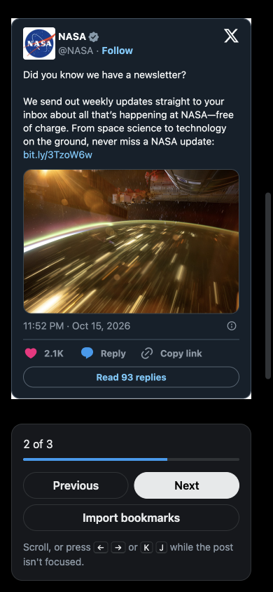
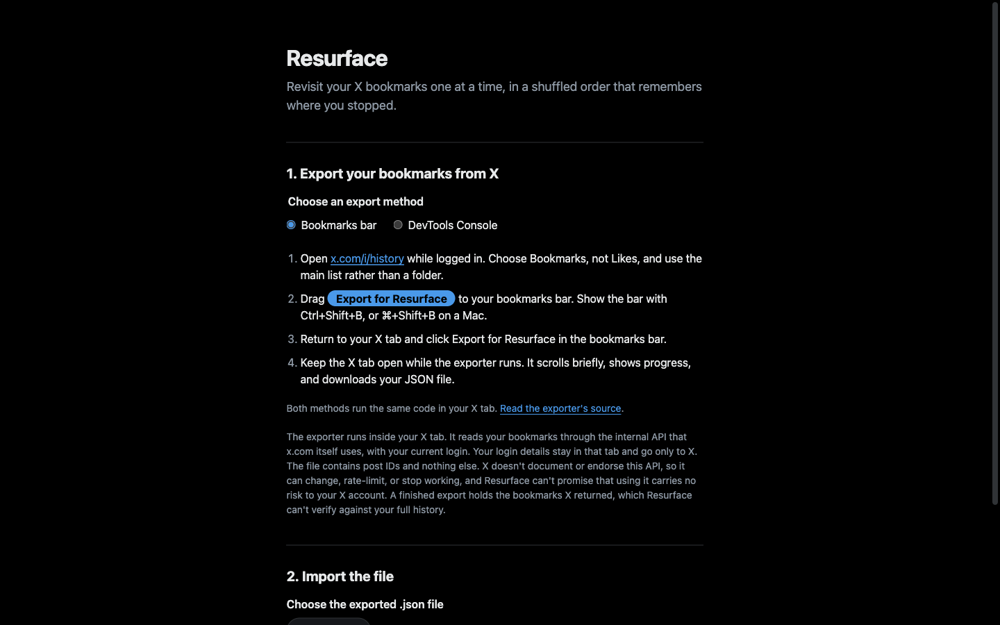
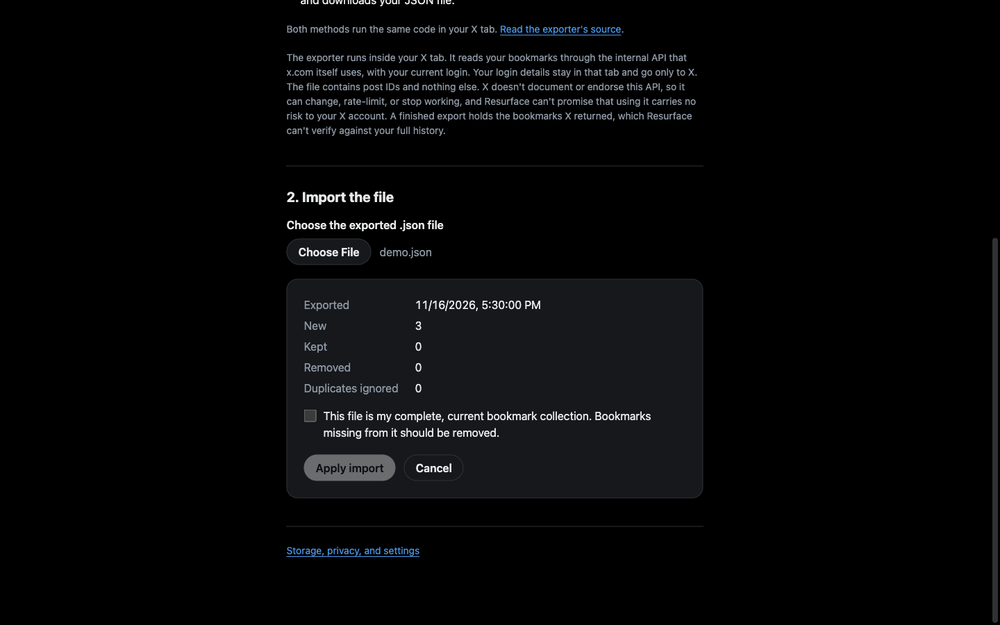

# Resurface

Resurface shuffles your X bookmarks and shows them one at a time, so the posts you saved and forgot come back. It remembers where you stopped.

[Open Resurface](https://rbajaj1997.github.io/resurface/). It's free, and there's no account and no server.

<p align="center">
  
</p>

X lists bookmarks newest first, so older saves sink out of sight. Resurface puts them in a random order and shows one post per screen. You see every bookmark once before the shuffle starts over.

## Features

- One post per screen, shown with X's official embed, including images and video when X's embed shows them.
- A shuffled order that lasts between visits. Resurface saves your place and counts the posts you've passed.
- Next and Previous buttons, scrolling, and the ← → or K J keys.
- Re-import whenever you like. New bookmarks are mixed into the part of the shuffle you haven't seen, and bookmarks you removed on X drop out.
- A preview before every import that counts new, kept, and removed bookmarks. Nothing changes until you confirm.
- Your collection stays in your browser. Resurface has no account, no server, and no analytics.

<p align="center">
  
</p>

## Get started

Use desktop Chrome, Edge, or Brave, logged in to X in the same browser profile.

### 1. Export your bookmarks from X

Open [x.com/i/history](https://x.com/i/history) and choose the Bookmarks tab. The exporter runs only there. It won't run on Likes, on a bookmark folder, on `x.com/i/bookmarks`, or on `twitter.com`.

Start the exporter in one of two ways. Both run the same code, and the home page links to its source.

#### From the bookmarks bar

1. On the [Resurface home page](https://rbajaj1997.github.io/resurface/), drag Export for Resurface to your bookmarks bar. Ctrl+Shift+B, or ⌘+Shift+B on a Mac, shows the bar.
2. Go back to your X tab and click Export for Resurface.

#### From the DevTools Console

1. On the Resurface home page, choose DevTools Console and click Copy export script. View script shows the code before you copy it.
2. In your X tab, open the Console with Ctrl+Shift+J, or ⌘+Option+J on a Mac. Paste the script and press Enter. Your browser may ask you to allow pasting first. Only paste code you have read and trust.

Keep the X tab open while the exporter runs. It scrolls the page for a moment, shows its progress, and downloads `resurface-bookmarks-YYYY-MM-DD.json`. The file holds post IDs and nothing else.

<p align="center">
  
</p>

### 2. Import the file

On the Resurface home page, choose the file under Import the file. Resurface shows what the import adds and removes. Confirm that the file is your complete collection, then click Apply import. The reader opens.

<p align="center">
  
</p>

### Keep it current

Run the exporter again later and import the new file. Your shuffle continues where you left it.

## Privacy

- Resurface is a static site with no backend. Your collection is a list of post IDs and your place in the shuffle, stored in your browser's IndexedDB.
- The exporter runs in your X tab with your current login. Your login stays in that tab and goes only to X.
- Each post card is an X embed, so loading it contacts X. Resurface asks X not to use the embeds for personalization, but X still sees the requests.
- Resurface loads no analytics and no external fonts.
- Settings has Reset collection. It removes your collection and progress from Resurface, not from X.

## Before you use it

- The exporter uses X's undocumented internal API, the same one x.com uses. X doesn't endorse Resurface and can change, rate-limit, or block that API at any time. Resurface can't promise that using it carries no risk to your X account.
- An export holds the bookmarks X returned. Resurface can't check it against your full bookmark history.
- If you already scrolled to the end of your bookmarks, reload the page before you run the exporter.
- Deleted, protected, or restricted posts may not show. Blockers such as Brave Shields can stop the cards from loading.
- The cards need a network connection. The saved IDs aren't an offline archive.
- Browser storage isn't a backup or a sync service. Clearing site data, a private window, or another browser profile starts an empty collection, and your collection doesn't follow you to other devices.
- Resurface supports desktop Chrome, Edge, and Brave. The reader fits a narrow window, but the exporter needs a desktop browser.

The screenshots show the live site with a three-post demo collection of public posts from [@NASA](https://x.com/NASA) and [@jack](https://x.com/jack). They aren't anyone's real bookmarks, and neither account is affiliated with Resurface.

## Run it locally

Resurface uses Vite, React, and TypeScript with plain CSS.

```sh
npm install
npm run dev
npm run build
npm run preview
npm run lint
```

- `npm run dev` serves http://localhost:5173/resurface/.
- `npm run build` pre-renders the home page and writes the static site to `dist/client`.
- `npm run preview` serves `dist/client`.

The exporter's readable source is `bookmarklet/export.js`. The build minifies it into the bookmarklet link and the Console script. `src/snapshot.ts` defines the export file format.

## Deploy your own copy

`.github/workflows/pages.yml` builds the site and publishes `dist/client` to GitHub Pages on every push to `main`. In your repository, set Settings > Pages > Source to GitHub Actions. The site expects the path `/resurface/`. If your repository has another name, change `base` in `vite.config.ts`.

## Contributing

Write commit messages as [Conventional Commits](https://www.conventionalcommits.org/), for example `fix: keep the reader position after import` or `docs: clarify export steps`. Product decisions and their reasons are in [plans/PLAN.md](plans/PLAN.md).
